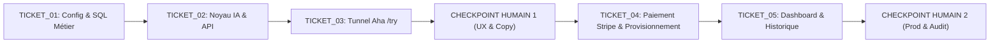

# Roadmap & DAG des Tickets (`[Nom du SaaS]`)

> Découpage vertical strict : chaque ticket produit une valeur vérifiable de bout en bout, tient en `1` session `< 20k` tokens et respecte `< 300` lignes/fichier.

## 1. Graphe de Dépendances (DAG)

## 2. Liste des Tickets
| ID | Fichier | Dépendances | Critère de Clôture |
| :--- | :--- | :--- | :--- |
| `T01` | `specs/tickets/TICKET_01_SQL_CONFIG.md` | — | Migration SQL appliquée, `0` alerte Advisor, types régénérés |
| `T02` | `specs/tickets/TICKET_02_CORE_AI.md` | `T01` | Schéma Zod + noyau pur + route API + test Vitest vert |
| `T03` | `specs/tickets/TICKET_03_TUNNEL_UI.md` | `T02` | Parcours `/try` mobile `375px` + desktop, draft local, `0` AI slop |
| `T04` | `specs/tickets/TICKET_04_CHECKOUT_E2E.md` | `T03` | Stripe Hosted Checkout + webhook idempotent vérifié `npm run test:webhook` |
| `T05` | `specs/tickets/TICKET_05_DASHBOARD_POLISH.md` | `T04` | Dashboard connecté, empty state, audit `red-team` + `npm run check` exit `0` |

## 3. Checkpoints Humains Obligatoires
- **Checkpoint 1** : validation copy landing/tunnel + test mobile réel (`cloudflared` tunnel si besoin).
- **Checkpoint 2** : validation Stripe Live, RLS Advisor `0` alerte, décision déploiement `vercel --prod`.
